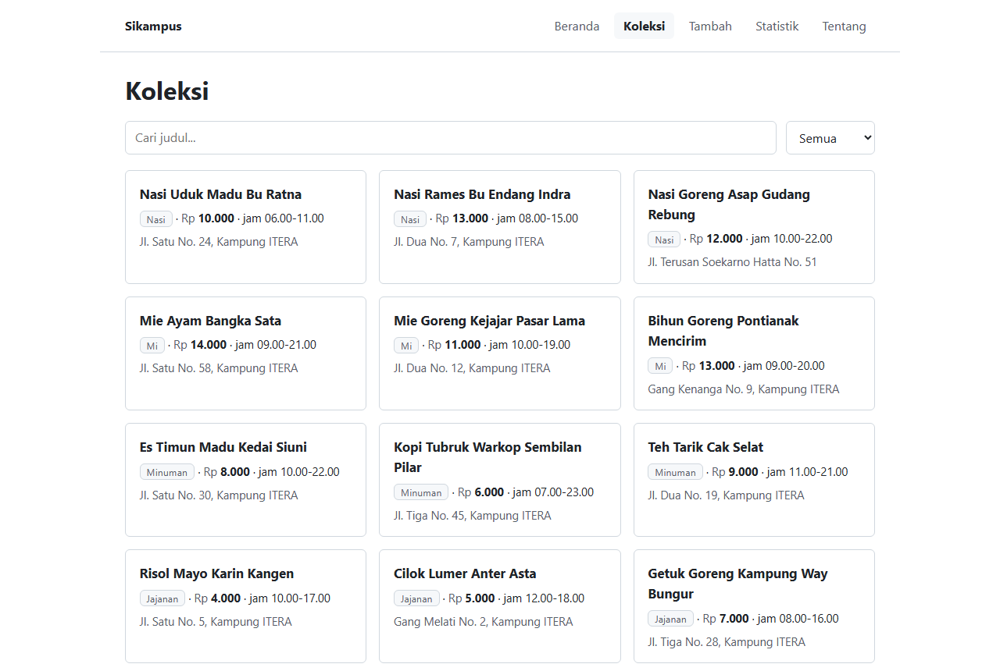
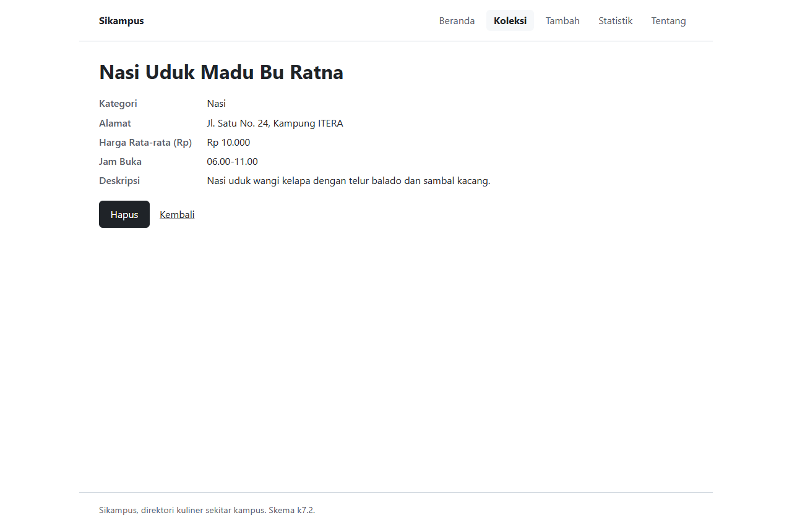
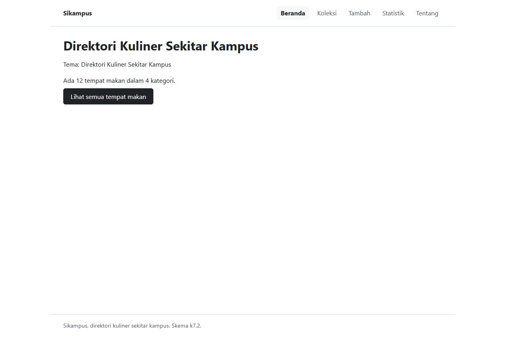
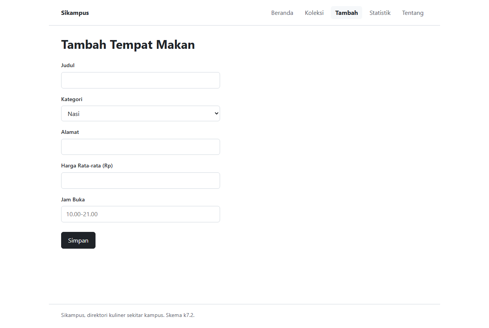

# Sikampus, Direktori Kuliner Sekitar Kampus

Tugas Ujian Tengah Semester IF25-22014 Pengembangan Aplikasi Web (Ganjil 2026/2027).

| | |
|---|---|
| Nama | AGIT FADILLAH |
| NIM | 124140157 |
| Kelas | RB |
| Tema | Direktori Kuliner Sekitar Kampus |

URL deployment: <https://agitfadillah.github.io/uts-paw/>

## Fitur

- Beranda menampilkan nama tema beserta ringkasan jumlah item dan jumlah kategori.
- Koleksi berisi 12 tempat makan dalam bentuk kartu, lengkap dengan kolom pencarian
  berdasarkan judul (`input type="search"`) dan saringan kategori.
- Detail tempat makan memuat semua field (kategori, alamat, harga rata-rata, jam buka,
  deskripsi), tombol Hapus dengan konfirmasi `window.confirm`, serta tautan kembali.
  Id yang tidak ada menampilkan pesan tidak ditemukan.
- Form tambah item terkontrol dengan validasi di JavaScript (judul wajib, minimal
  3 karakter) ditampilkan lewat `role="alert"`. Data baru disimpan ke localStorage,
  jadi tetap ada setelah halaman diperbarui.
- Statistik berupa tabel HTML jumlah tempat makan per kategori beserta totalnya.
- Tentang berisi nama, NIM, kelas, tema, dan tautan repo GitHub ini.
- Rute yang tidak dikenal menampilkan halaman 404 dengan tautan kembali ke beranda.
- Data awal diambil dari `public/data/koleksi.json` menggunakan `fetch` dengan
  `async/await`, ada keadaan memuat dan gagal memuat.

## Cara menjalankan

```bash
cd app
npm install
npm run dev
```

Untuk menjalankan test dan pemeriksaan:

```bash
npm test   # Vitest + React Testing Library
npm run lint
npm run cek
```

## Tangkapan layar








